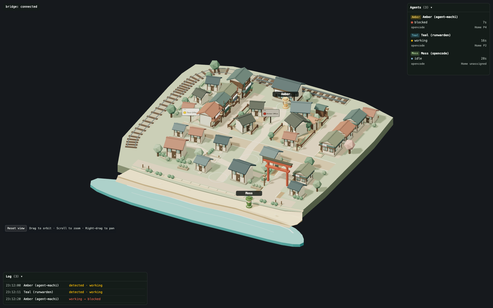

# Agent Machi

[](LICENSE)


**In the office when working. At the station when blocked. On the beach when idle.**

Agent Machi is a single-binary visual companion for [Herdr](https://herdr.dev):
it renders your coding agents as residents of a small 3D Kamakura town, where
each agent's location tells you its state at a glance. No dashboards to read,
no panes to flip through. If someone is standing on the station platform, an
agent needs you.

## Overview



Herdr agents work in panes, and panes hide each other. An agent can sit blocked
on a question for an hour while you look at another tab. The state exists, but
nothing in the room shows it.

Agent Machi turns that state into a place. Each agent gets a character and an
office in the town. Working agents are inside, with their office sign lit. The
moment one gets blocked, it walks out and waits for you on the station platform.
When it finishes, its sign grows a pulsing badge until you look at it. Idle
agents go down to the beach.

| Herdr state | Where the agent is |
| --- | --- |
| `working` | Inside its office, sign lit |
| `blocked` | On the station platform, waiting for you |
| `done` | Inside its office, sign lit, with a pulsing **!** badge |
| `idle` | On the beach |
| `unknown` | Stays where it was |

## Features

- **State you can read from across the room**: location, sign lamps, and badges
  carry the information. The town is the status page.
- **Single binary, zero arguments**: the Go binary embeds the town and talks to
  Herdr itself. Run it and your browser opens on the town. No Node, no build
  step, no config file.
- **Nothing leaves your machine**: the binary reads Herdr's local Unix socket
  and serves the page locally. No accounts, no cloud, no telemetry.
- **Roster and Log**: every agent with its state, how long it has been in it,
  and its office; plus an event Log that survives page reloads.
- **Names you can map**: signs read `Amber Office`; the roster shows
  `Amber (agent-machi)`, character first, project in parentheses.
- **Six residents**: Amber, Teal, Moss, Plum, Slate, and Sand. Agents beyond
  the sixth still appear in the roster and the Log.
- **Full camera control**: orbit, zoom, and pan, with a Reset view button.
- **Trailer mode**: add `?trailer=1` to hide the panels and play a fixed
  wide-to-close camera orbit around the town.

## Quick Start

### Requirements

- Herdr, tested with 0.9.5
- macOS or Linux (arm64 or amd64)

### Run the binary

Download the binary for your platform from the
[Releases](https://github.com/happyeric77/agent-machi/releases) page, then:

```sh
./agent-machi
```

That is the whole setup. The binary finds Herdr's socket, starts serving on
port 8731, and opens http://localhost:8731 in your browser. From another
machine on your network or tailnet, open `http://<host>:8731` instead.

### Build from source

Requires Go and Node.js (Node is only used to build the web frontend):

```sh
./scripts/build-binary.sh
./agent-machi
```

## Configuration

Everything has a default; configuration is only for non-standard setups.

| Environment variable | Default | Purpose |
| --- | --- | --- |
| `PORT` | `8731` | Port the town and API are served on |
| `HOST` | `0.0.0.0` | Bind address; use `127.0.0.1` to serve only this machine |
| `HERDR_SOCKET_PATH` | auto | Explicit path to Herdr's Unix socket |
| `HERDR_SESSION` | auto | Named Herdr session to connect to |
| `AGENT_MACHI_EVENTS_LOG` | `~/.local/share/agent-machi/events.jsonl` | Where the event log is kept |
| `AGENT_MACHI_NO_OPEN` | unset | Set to `1` (or pass `--no-open`) to skip opening the browser |

## How it works

The binary connects to Herdr's Unix socket API and keeps a live table of
agents and their states. State changes are pushed to the page as server-sent
events; the page plans each character's walk through the town (station, offices,
beach) on a route graph and animates it. Every event is also appended to a
JSONL log on disk, which is what the Log panel reads back after a reload.
Protocol notes from reverse-engineering the Herdr 0.9.5 socket API live in
`docs/herdr-schema-notes.md`.

## Development

The web frontend is Vite + Three.js under `src/`; the original Node bridge is
kept in `tools/herdr-bridge/` as the reference implementation and for scripted
FAKE scenarios used in tests and demos:

```sh
npm install
npm run bridge:fake   # scripted agents, no Herdr needed
FAKE_SCENARIO=trailer npm run bridge:fake   # opening scene for ?trailer=1
npm run dev           # http://localhost:5173
```

The Go bridge is verified against the Node bridge scenario by scenario; the
frontend is identical for both.

## License

MIT
