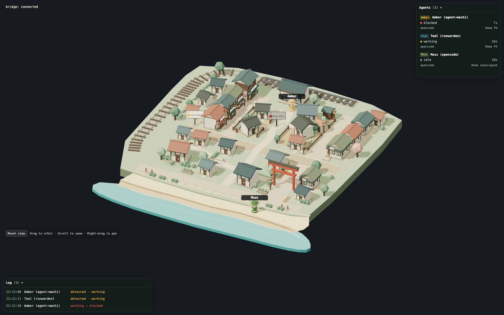

# Agent Machi

[](LICENSE)


**In the office when working. At the station when blocked. On the beach when idle.**

Agent Machi is a single-binary visual companion for [Herdr](https://herdr.dev):
it renders your coding agents as residents of a small 3D Kamakura town, where
each agent's location tells you its state at a glance. No dashboards to read,
no panes to flip through. If someone is standing on the station platform, an
agent needs you.

## Overview



Herdr agents work in panes, and panes hide each other. An agent can sit blocked
on a question for an hour while you look at another tab. The state exists, but
nothing in the room shows it.

Agent Machi turns that state into a place. Each agent gets a character and an
office in the town. Working agents are inside, with their office sign lit. The
moment one gets blocked, it walks out and waits for you on the station platform.
When it finishes, its sign grows a pulsing green check until you look at it. Idle
agents go down to the beach.

| Herdr state | Where the agent is |
| --- | --- |
| `working` | Inside its office, sign lit |
| `blocked` | On the station platform, waiting for you, pulsing yellow **!** above its name |
| `done` | Inside its office, sign lit, with a pulsing green check |
| `idle` | On the beach |
| `unknown` | Stays where it was |

## Features

- **State you can read from across the room**: location, sign lamps, and badges
  carry the information. The town is the status page.
- **Single binary, zero arguments**: the Go binary embeds the town and talks to
  Herdr itself. Run it and your browser opens on the town. No Node, no build
  step, no config file.
- **Nothing leaves your machine**: the binary reads Herdr's local Unix socket
  and serves the page locally. No accounts, no cloud, no telemetry.
- **Roster and Log**: every agent with its state, how long it has been in it,
  and its office; plus an event Log that survives page reloads.
- **Names you can map**: signs read `Amber Office`; the roster shows
  `Amber (agent-machi)`, character first, project in parentheses.
- **A full town**: up to 24 agents drawn as characters, each with its own
  silhouette and colours worked out from its id. Agents beyond the 24th still
  appear in the roster and the Log.
- **Full camera control**: orbit, zoom, and pan, with a Reset view button.
- **Trailer mode**: add `?trailer=1` to hide the panels and play a fixed
  wide-to-close camera orbit around the town.

## Quick Start

### Requirements

- Herdr, tested with 0.9.5
- macOS or Linux (arm64 or amd64)

### Run the binary

Download the binary for your platform from the
[Releases](https://github.com/happyeric77/agent-machi/releases) page, then:

```sh
./agent-machi
```

That is the whole setup. The binary finds Herdr's socket, starts serving on
port 8731, and opens http://localhost:8731 in your browser. From another
machine on your network or tailnet, open `http://<host>:8731` instead.

### Build from source

Requires Go and Node.js (Node is only used to build the web frontend):

```sh
./scripts/build-binary.sh
./agent-machi
```

## Configuration

Everything has a default; configuration is only for non-standard setups.

| Environment variable | Default | Purpose |
| --- | --- | --- |
| `PORT` | `8731` | Port the town and API are served on |
| `HOST` | `0.0.0.0` | Bind address; use `127.0.0.1` to serve only this machine |
| `HERDR_SOCKET_PATH` | auto | Explicit path to Herdr's Unix socket |
| `HERDR_SESSION` | auto | Named Herdr session to connect to |
| `AGENT_MACHI_EVENTS_LOG` | `~/.local/share/agent-machi/events.jsonl` | Where the event log is kept |
| `AGENT_MACHI_NO_OPEN` | unset | Set to `1` (or pass `--no-open`) to skip opening the browser |
| `AGENT_MACHI_INGEST_TOKEN` | unset | Enables `POST`/`DELETE /report` when non-empty; unset or empty means the endpoint answers `404` |
| `AGENT_MACHI_INGEST_TTL_SECONDS` | `900` | How long a reported resident may stay silent before it is removed |

### Modes

A bridge process has exactly one feeding source, chosen in this order:

| Mode | Selected when | What runs |
| --- | --- | --- |
| External | `AGENT_MACHI_INGEST_TOKEN` is non-empty | `POST`/`DELETE /report`; no Herdr watcher, no FAKE |
| FAKE | no token and `FAKE=1` | the scripted demo scenario |
| Local Herdr | no token and no FAKE | the Herdr watcher |

The token test is on the raw value: unset and explicitly empty both mean
disabled, while a whitespace-only value is non-empty and therefore selects
external mode. External mode wins over `FAKE=1`, so a report-only process
never advertises itself as a demo, and `HERDR_SOCKET_PATH`,
`HERDR_SESSION`, and `AGENT_MACHI_INGEST_TTL_SECONDS` cannot override it.
Startup says which mode took effect.

## Report API

An agent that does not live in a Herdr pane can still appear in the town.
Start the bridge with a non-empty token:

```sh
export AGENT_MACHI_INGEST_TOKEN=choose-a-long-random-value
./agent-machi
```

With no token (or an empty one) the endpoint does not exist, and the town
behaves exactly as before: any method on `/report` answers `404`.

Enabling ingest also switches the town to external mode: the Herdr integration
and the FAKE demo do not start, so reported residents are the only ones in the
town.

**Exposure:** the bridge listens on `0.0.0.0` by default, so enabling reports
makes the endpoint reachable from any network that can reach the host, subject
to your firewall, not just this machine, and the bearer token is the only
guard. Use a long random value, and set `HOST=127.0.0.1` (or a tailnet
address) when reporters do not need LAN access. Requests are plain HTTP: the
token crosses the network in clear text, so keep the endpoint on a trusted
network or put a TLS proxy in front of it.

### Authentication

Every request needs `Authorization: Bearer $AGENT_MACHI_INGEST_TOKEN`. A
missing or wrong token gets `401` with the body `unauthorized`. The token is
checked before the method, so a `405` always means the token was valid.

### POST /report

One JSON object, at most 8 KiB, no unknown fields, and no trailing data.

| Field | Required | Type | Meaning |
| --- | --- | --- | --- |
| `source` | yes | string | Who is reporting, for example a tool name. 1-128 bytes, no `:` |
| `id` | yes | string | Agent id inside that source. 1-128 bytes, no `:` |
| `status` | yes | string | `working`, `blocked`, `done` or `idle` |
| `name` | no | string | Display name in the Roster. 0-128 bytes; `null` is rejected |
| `agent` | no | string | Agent label shown under the name. 0-128 bytes; `null` is rejected |

`source` and `id` together identify the resident: its pane id is
`ext:<source>:<id>`, and two sources may use the same id. The Roster display
name falls back from the trimmed `name` to the trimmed `agent` to the pane id,
and duplicate display names get a numeric suffix. Up to 24 residents are drawn
as characters at a time, each with its own look and a name tag; agents beyond
the 24th appear in the Roster and the Log only. The first seven to arrive get
the authored houses and an office sign reading their character name, for
example `Amber Office`, never the reported name; everyone else works from the
work area and is labelled `Houseless` in the Roster. A resident gives its house
up when it leaves.

Response:

```json
{"ok":true,"pane_id":"ext:ci:build","status":"working","changed":true}
```

`changed` is `false` when the reported status was already the resident's
status. That report only renewed the residency; nothing else happened.

The bridge stores `name` and `agent` when the resident is created, and
replaces them on every status change: a status change that omits them clears
them, and the resident falls back as described above. A same-status heartbeat
leaves both fields untouched.

### DELETE /report

`DELETE /report?source=<source>&id=<id>` sends the resident away and answers
`{"ok":true}`. The query values use the same rules as POST identifiers.
Removal changes only the next snapshot: no Log row and no SSE event. Removing
an agent that is not there also succeeds, so the call is idempotent.

### Statuses

Only the four states above are accepted. `unknown` is a bridge-side state for
Herdr rows and cannot be reported.

### Heartbeat and expiry

A reported resident stays only while it keeps talking.

- Re-report at least every 5 minutes. That is a recommendation, not a server
  rule; report more often if you shorten the window. The default window is 15
  minutes (`AGENT_MACHI_INGEST_TTL_SECONDS`, 900 seconds).
- A same-status report is silent: no Log row, no SSE event, and the Roster age
  (`status_since`) does not reset.
- A status change publishes an SSE event and writes a Log row, like a Herdr
  pane does.
- When the window runs out, the resident disappears from the next snapshot,
  usually within 30 seconds of the deadline. Nothing is logged and no SSE
  event is sent: it is as if the pane closed.

### State lives in the bridge's memory

Reported residents and their leases exist only in the bridge process's memory;
nothing about them is restored on restart, so every reported resident vanishes
from the town until it reports again. Creation and status changes are appended
to the event Log on a best-effort basis (a log write can fail or be dropped),
which is history, not state.

### What a success means

For `POST`, `200` means the bridge accepted the status into its live table. It
does not mean the Log line reached disk, that an open SSE client received it,
or that the town has animated the change. For `DELETE`, `200` means the removal
was accepted, or that there was nothing to remove; treat it as idempotent.

| Status | When | Body |
| --- | --- | --- |
| `400` | malformed, oversized or trailing JSON, an unknown field, a missing or invalid field, or invalid DELETE parameters | `{"error":"..."}` |
| `401` | missing or wrong token | `unauthorized` |
| `404` | the bridge was started without a token | `404 page not found` |
| `405` | a method other than `POST` or `DELETE`, with a valid token | `method not allowed` |

### Examples

```sh
export AGENT_MACHI_INGEST_TOKEN=choose-a-long-random-value   # reporter shell

curl -s http://127.0.0.1:8731/report \
  -H "Authorization: Bearer $AGENT_MACHI_INGEST_TOKEN" \
  -H 'Content-Type: application/json' \
  -d '{"source":"ci","id":"build","name":"build-runner","status":"working"}'

curl -s -X DELETE \
  "http://127.0.0.1:8731/report?source=ci&id=build" \
  -H "Authorization: Bearer $AGENT_MACHI_INGEST_TOKEN"
```

The same binary can report without curl:

```sh
agent-machi report --id build --status working --name build-runner
agent-machi report --id build --remove
```

`agent-machi report` sends one request and exits. It requires `--id` plus
either `--status` (one of the four) or `--remove`. Optional flags are
`--source` (default `cli`), `--name`, `--agent` and `--url`. It reads the
token from `AGENT_MACHI_INGEST_TOKEN` and the address from `--url`, then
`AGENT_MACHI_BRIDGE_URL`, then `http://127.0.0.1:8731`. Exit codes: `0`
accepted; `1` the bridge refused the report, could not be reached, or answered
unexpectedly (an HTTP 200 without `{"ok":true}` is a failure); `2` the
arguments or URL were rejected before any request was sent (`--help` also
exits `2`).

## How it works

The binary connects to Herdr's Unix socket API and keeps a live table of
agents and their states. State changes are pushed to the page as server-sent
events; the page plans each character's walk through the town (station, offices,
beach) on a route graph and animates it. Every event is also appended to a
JSONL log on disk, which is what the Log panel reads back after a reload.
Protocol notes from reverse-engineering the Herdr 0.9.5 socket API live in
`docs/herdr-schema-notes.md`.

## Development

The web frontend is Vite + Three.js under `src/`; the original Node bridge is
kept in `tools/herdr-bridge/` as the reference implementation and for scripted
FAKE scenarios used in tests and demos:

```sh
npm install
npm run bridge:fake   # scripted agents, no Herdr needed
FAKE_SCENARIO=trailer npm run bridge:fake   # opening scene for ?trailer=1
npm run dev           # http://localhost:5173
```

The Go bridge is verified against the Node bridge scenario by scenario; the
frontend is identical for both.

## License

MIT
